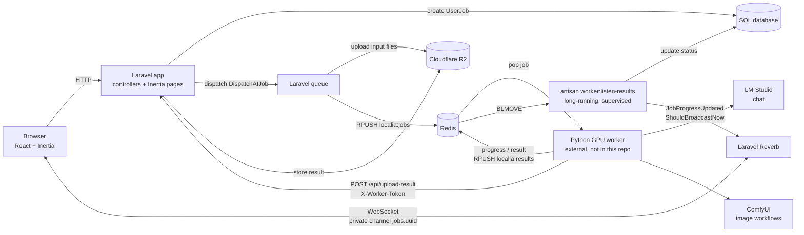

# Localia GenAI Platform

A self-hosted, invite-only web platform that turns locally run generative AI models (LM Studio for chat, ComfyUI for image generation) into configurable services that users launch from the browser, with real-time job progress.

## What it does

Running models on a local GPU machine is cheap and private, but it is hard to share with a team: there is no UI, no queue, no access control, and the GPU box is usually not reachable from the public web server. Localia sits between the users and that GPU machine:

- **Dynamic AI services**: admins define services (name, engine, ComfyUI workflow file, and a list of typed inputs such as text, textarea, image, video or file) without writing code. The launch form and its server-side validation are generated from that definition.
- **Asynchronous job pipeline**: every request becomes a tracked job (pending, processing, completed, failed) that is queued and handed to a remote Python worker over Redis.
- **Real-time progress**: the worker reports stage and percentage; the browser receives updates over WebSockets (Laravel Reverb) without polling or refreshing.
- **Continuous chat**: chat jobs can reference a parent job, so the conversation history (user and assistant turns) is carried forward to the LLM.
- **Object storage hand-off**: uploaded inputs and generated results are stored in Cloudflare R2 (S3-compatible), so the GPU worker never needs access to the web server disk.
- **Access control**: invitation-only registration (emailed, expiring tokens), user and admin roles, admin pages to manage services, invitations and jobs (including cancelling jobs).

## Architecture



How a request flows:

1. A user submits a service form. `JobController@store` builds validation rules from the service's input definitions, creates a `UserJob` (with chat history if it continues a previous job) and dispatches `DispatchAIJob`.
2. `DispatchAIJob` uploads any file inputs to R2, replaces them with public URLs, and pushes a JSON payload (engine, workflow file, inputs, chat history, callback channel) onto the `localia:jobs` Redis list.
3. An external Python worker on the GPU machine runs the job against LM Studio or ComfyUI. Large outputs (images, video) are sent to the token-protected endpoint `POST /api/upload-result`, which stores them in R2 and returns a URL.
4. The worker pushes progress and final results to `localia:results`. The `worker:listen-results` Artisan command consumes that list, updates the job and fires `JobProgressUpdated`, which Reverb delivers to the job's private channel. The channel is authorized only for the job owner or an admin.

`docs/supervisor-localia-listener.conf` is a Supervisor template to keep the listener running in production.

## Tech stack

- **Backend**: PHP 8.3, Laravel 13, Inertia.js (server adapter), Laravel Reverb (WebSockets), Laravel Horizon, Redis (phpredis / predis)
- **Frontend**: React 19, Inertia.js, Vite, Tailwind CSS 4, shadcn/ui (Base UI), Laravel Echo + pusher-js, lucide-react, sonner
- **Storage**: SQLite or MySQL via Eloquent; Cloudflare R2 through the Flysystem S3 adapter (AWS SDK for PHP)
- **AI engines** (driven by the external worker): LM Studio, ComfyUI (including a FLUX.2 Klein image-to-image workflow)
- **Ops**: Supervisor for the long-running Redis listener

## Running locally

### Requirements

- PHP 8.3+ with the `redis` (phpredis) extension, Composer
- Node.js and npm
- Redis on `localhost:6379`
- A Cloudflare R2 bucket (or another S3-compatible store) for file inputs and results
- To actually execute jobs: a compatible Python worker connected to LM Studio and/or ComfyUI (not included in this repository). Without it, the web app, auth, services admin and job creation still work, but jobs stay in `processing`.

### Configuration

```bash
cp .env.example .env
```

Then edit `.env`:

- `ADMIN_EMAIL`: email of the initial admin account.
- `ADMIN_PASSWORD`: required. `AdminSeeder` throws an error if it is empty; it is used to create the initial admin account.
- `APP_NAME=localia` (already set in `.env.example`): the Redis key prefix is derived from `APP_NAME`, and the listener reads from `localia-database-localia:results`, so keep this value (or set `REDIS_PREFIX=localia-database-`).
- Queue and Redis: `QUEUE_CONNECTION` (database or redis) and `REDIS_HOST` / `REDIS_PORT` / `REDIS_PASSWORD`.
- Fill in the Reverb, Cloudflare R2 and `WORKER_SECRET_TOKEN` values in `.env` (all are listed in `.env.example`).

### Commands

```bash
composer install
npm install
php artisan key:generate
touch database/database.sqlite        # when using SQLite
php artisan migrate --seed            # creates the admin user and three sample services

# in separate terminals
php artisan serve                     # http://localhost:8000
php artisan queue:work                # runs DispatchAIJob
php artisan reverb:start              # WebSocket server on localhost:8080
php artisan worker:listen-results     # consumes worker results from Redis
npm run dev                           # Vite dev server
```

Log in at `http://localhost:8000` with the admin account, then invite users from the admin area. Mail uses the `log` driver by default, so invitation links appear in `storage/logs/laravel.log`.

## What I learned / key technical decisions

- **Decoupling the web app from the GPU machine.** I made Redis lists the only contract between Laravel and the Python worker, and moved every file through R2 instead of the local disk. The web server and the GPU box never need to share a filesystem or open inbound ports to each other.
- **At-least-once delivery for worker results.** I started with Redis pub/sub and then `BLPOP`, and found that a message is lost if the listener drops the connection right after the pop. I switched to `BLMOVE` into a processing list, removing the message only after it has been handled, recovering leftovers on restart, and enabling TCP keepalive to detect dead connections behind NAT.
- **Broadcasting synchronously for live progress.** With `ShouldBroadcast` the progress event became just another queued job, so the UI looked connected but never updated when the queue worker was idle. Moving `JobProgressUpdated` to `ShouldBroadcastNow` sends it straight to Reverb from the listener.
- **Data-driven services instead of hard-coded endpoints.** Services and their inputs live in the database, and the request validation rules (file, image, video MIME types, text length) are generated from those definitions, so adding a new ComfyUI workflow is an admin task, not a code change.
- **Production details that only show up across processes.** I had to make the local disk write files with group-readable permissions so the queue worker (a different OS user from PHP-FPM) could read uploads, and I moved the admin seed password out of the code into `ADMIN_PASSWORD`.

## Author

**Washington X. Quevedo**

- LinkedIn: https://www.linkedin.com/in/wxquevedo
- GitHub: https://github.com/wx-quevedo
